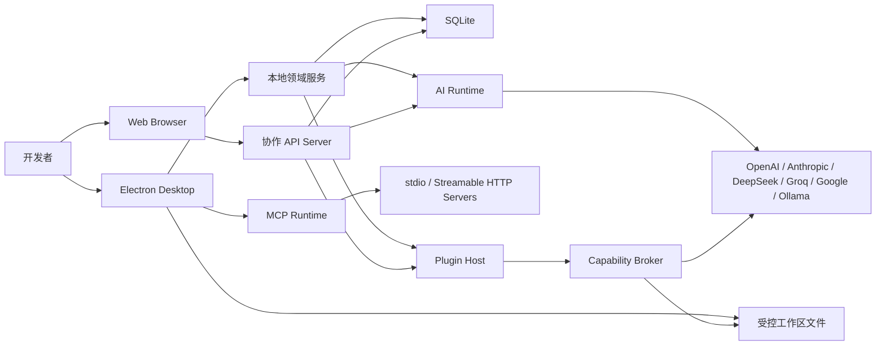

# E Agent 架构

> 本文同时记录当前架构和目标架构。凡涉及 LLM 上下文摘要、逐请求排队位置、
> 断流恢复、告警分发和 AI 文件写入闭环的描述，必须结合
> [交付状态](delivery-status.md) 判断是否已经落地；设计目标不等于当前能力。

## 1. 目标与约束

E Agent 在不复制业务逻辑的前提下同时支持：

- 本地优先桌面应用：数据默认写入本机 SQLite，文件能力通过受控 IPC 暴露；
- 自建 Web 协作：浏览器只访问 HTTPS API，不接触本地文件系统或可解密 Key；
- 多供应商模型：OpenAI 兼容接口是基础适配层，厂商差异封装在 Provider；
- 可扩展执行：Skill 是声明式 Prompt/Workflow，插件是独立进程中的代码扩展；
- 生产可观测：每个请求有 request ID、结构化日志、用量记录和聚合指标；
- 安全失败：缺少权限、主密钥、签名凭据或不满足契约时拒绝继续。

SQLite 单文件部署适合单机和小团队单实例。它不是多写节点数据库；需要水平扩展
写入时，应先引入服务器数据库适配层，而不是共享 SQLite 文件。

## 2. 系统上下文

### 信任边界

1. Renderer/浏览器是不可信展示层，不持有数据库、主密钥或 Node.js 权限。
2. Electron preload 是窄接口边界；只暴露显式 IPC 通道和可序列化值。
3. API Server/主进程持有领域权限，但日志层必须先脱敏。
4. Plugin Host 是故障隔离边界；所有高风险能力仍需回到 Capability Broker。
5. 模型供应商和用户配置代理是外部不可信网络。
6. SQLite、日志、备份和插件数据目录均是敏感持久化资产。
7. MCP Server、其工具 Schema/注解和返回内容均为外部不可信输入。stdio 进程继承当前
   操作系统用户权限；Streamable HTTP 的目标网络边界由用户配置，MCP 运行时不是恶意
   Server 的可信沙箱。

## 3. Monorepo 分层

| 层     | 包/应用                   | 职责                                       |
| ------ | ------------------------- | ------------------------------------------ |
| 入口   | `apps/desktop`            | 窗口、生命周期、IPC、更新、桌面通知        |
| 入口   | `apps/web`                | Web 启动、路由挂载、静态资源               |
| 入口   | `apps/server`             | HTTP/SSE、认证、中间件、健康检查、关闭     |
| 隔离   | `apps/plugin-host`        | 加载一个插件、协议通信、卸载处理器         |
| UI     | `packages/app-ui`         | 页面、细粒度组件、Store、i18n、传输抽象    |
| 契约   | `packages/contracts`      | Zod schema、DTO、流事件、错误形状          |
| 领域   | `packages/core`           | 队列、Key/配额、上下文、会话、用量策略     |
| AI     | `packages/ai-runtime`     | Provider 客户端、发现、SSE、重试、能力推断 |
| 工具   | `packages/mcp-runtime`    | MCP stdio/HTTP、握手、发现、调用和生命周期 |
| 数据   | `packages/database`       | Drizzle schema、迁移、Repository           |
| 安全   | `packages/security`       | AES-GCM、口令哈希、Token、敏感字段脱敏     |
| 可观测 | `packages/observability`  | 日志、请求上下文、指标、性能计时           |
| 扩展   | `packages/plugin-sdk`     | Manifest、宿主协议和插件 API 类型          |
| 扩展   | `packages/plugin-runtime` | 安装、审批、启停、宿主、能力代理、热加载   |
| 自动化 | `packages/skills`         | Skill schema、注册表、模板和 DAG Workflow  |

依赖方向遵循“入口 → 领域/运行时 → 契约/数据/安全”。基础包不依赖 UI 或具体
入口。Desktop 和 Web 通过 `Transport` 接口复用 UI：一个实现调用安全 IPC，
另一个实现调用 HTTP/SSE。

## 4. 关键请求链

### 4.1 流式对话

1. UI Store 提交用户消息；HTTP/Desktop 传输生成幂等键。
2. Server/主进程使用共享 schema 验证 `SendChatRequest`，并建立 request ID。
3. 请求进入可配置并发队列；等待期间通过 `queue` 流事件发送当前排位、活跃数和
   等待数，开始执行或取消时发送 `position: null` 清除排位。
4. 上下文服务计算历史和项目记忆的 Token 预算；Desktop 可解析文件、目录和受限
   公网网页，Web 可解析受 SSRF/DNS/大小/类型约束的 `@web`，并明确拒绝浏览器
   无权读取的 `@file`/`@folder`。
5. 超过窗口阈值时使用设置的低成本模型压缩旧消息，并单独记录该次用量；模型不可用
   时退回确定性摘要，原消息仍保留在持久层。
6. Key 池排除暂停/超额/不健康 Key，再按轮询或优先级选取。
7. AI Runtime 使用独立代理和超时调用 Provider，按策略执行指数退避。
8. Server 以 SSE 发送 `queue`、`start`、`delta`、`reasoning_delta`、
   `tool_call_delta`、`usage`、`done` 或 `error` 事件；当前没有独立心跳事件。
9. Desktop 将 Thinking 与正文分开累计并持久化耗时；Renderer 在生成期间展开，
   完成后按用户偏好折叠、展开或隐藏，不会把推理文本拼进最终回答。
10. Desktop 最多执行四轮模型—工具循环。工作区读取/列表/文件名查找/文本搜索与最小化
    系统信息可自动完成；进程列表、文件写入 Diff、命令和所有浏览器工具进入独立审批状态。
    浏览器只提供 best-effort public-only 导航与只读提取/截图，不提供点击、输入、上传
    或下载；DNS 公网地址预检不是固定出口代理或严格 SSRF 隔离。
11. 已连接 MCP Server 的工具与内置工具合并后最多向模型暴露 64 项。第三方 MCP 工具
    始终逐次等待用户批准；“明确只读工具可自动执行”只影响受信任的内置只读工具，
    Server 的 `readOnlyHint`、destructive/open-world 注解仅供用户判断，不会绕过审批。
12. 最终消息、用量和 Key 消耗依次落库；当前不是单一数据库事务，错误日志经过脱敏。
13. UI 增量渲染，不等待完整响应；幂等缓存可复用已完成响应，但中断生成没有
    checkpoint/resume 协议。

非流式调用使用同一领域链，只在传输末端聚合为 JSON。

### 4.2 Key 生命周期

1. Renderer 通过 TLS/IPC 提交明文 Key；不进入 Zustand 持久化。
2. 服务端使用 `E_AGENT_MASTER_KEY` 派生 32 字节 AES Key。
3. 每次写入生成独立 96-bit IV，以 AES-256-GCM 加密并绑定用途 AAD。
4. 数据库保存版本化信封、掩码、额度、优先级和代理配置。
5. 解密仅发生在即将调用 Provider 的服务端范围；日志层接收前先脱敏。
6. 健康任务每小时使用轻量端点检查，并更新 healthy/warning/unhealthy 状态。
7. 超出日/月 Token 或成本限额后 Key 暂停；应用状态栏和桌面原生成本通知已接通，
   邮件告警仍需部署 SMTP 分发器。

主密钥轮换需要“旧密钥解密 → 新密钥加密 → 原子替换”的专用维护任务和完整
备份，不能直接替换环境变量。

### 4.3 插件调用

1. Installer 只接受本地目录或无凭据 HTTPS Git URL。
2. 安装到 staging，拒绝符号链接/路径穿越/超限文件，校验 Manifest 和树摘要。
3. 同版本替换先备份；成功后原子切换，失败恢复。
4. 用户查看权限差异并显式审批；安装不等于批准或启用。
5. Runtime 启动独立 Plugin Host，通过结构化协议注册命令/Hook/Provider。
6. 网络、文件、环境变量、通知全部由 Broker 对 Manifest 与审批快照二次判断。
7. 停用会终止宿主并撤销注册项；卸载移动到可恢复 `.trash`。
8. 开发模式监听变化，去抖后重启该插件宿主。
9. Server 聊天及认证路由通过扩展层触发观察型 Hook；扩展层只选择已启用、已批准且
   Manifest 显式声明事件的插件，并把严格校验、无凭据和无正文的 JSON 元数据发给
   Host。单插件错误按安全错误码记录和审计，不向主业务传播。
10. Desktop 在用户批准的原子文件写入前后触发 `file:before-save` /
    `file:after-save`；只发送相对路径、字节数、SHA-256、变更 ID、角色和结果，
    插件失败不会改变写盘决定。

独立进程主要提供故障与资源隔离，不应被视为能抵抗任意恶意 Node.js 代码的
绝对沙箱。生产环境只安装可信来源并固定提交/版本。

### 4.4 分层系统提示与 Skill 合并

1. Core 按稳定顺序构建身份、安全、实际工具清单、上下文、任务场景和输出六个段落。
2. Locale 从最新用户消息推断；bug-fix、architect、refactor、security-audit、
   browser-research、computer-operator 等场景只调整执行策略，不扩大授权范围。
3. Desktop/Web/共享入口分别声明表面能力；未实际暴露的工具不会写入本轮工具清单。
4. 基础 Prompt 在每轮请求中按可信配置重新构建；调用方传入的 Skill/上下文 system
   消息统一降级为受约束的补充任务说明，伪造版本标记不会绕过基础安全段。网页、文件和
   工具结果中的指令不能覆盖系统层安全规则。
5. Prompt 是模型行为约束，不替代 IPC Schema、工作区绑定、审批、网络检查、超时和
   输出大小限制；强制安全仍由确定性运行时执行。

### 4.5 MCP Server 与工具调用

1. Desktop 通过 `DesktopSecretStore` 从私有应用数据目录加载整份 AES-256-GCM 加密的
   版本化 MCP 配置；旧明文配置读取成功后会迁移到加密状态、删除原文件并验证其消失，
   删除无法确认时会阻止启动。损坏或超限的加密配置会 fail closed 并拒绝初始化，避免
   静默覆盖原数据。Renderer 摘要不返回 Header、环境变量或 URL 查询/凭据信息，只返回
   是否存在凭据。
2. stdio 以 `shell:false` 启动配置的可执行文件，使用最小环境并限制消息、并发、超时
   与关闭期限；这仍是当前 OS 用户权限的本地进程，不是容器或权限沙箱。
3. Streamable HTTP 支持 JSON、POST SSE 和后台 GET 事件流；远程地址默认要求 HTTPS，
   仅 localhost 可默认使用 HTTP。该传输不应被误解为通用企业出口或私网隔离策略。
4. 运行时完成 initialize、工具分页发现、`list_changed` 刷新、稳定命名空间、
   `tools/call`、取消、错误脱敏和有界结果映射。当前只实现 MCP Tools，不导入 MCP
   Resources 或 Prompts。
5. 所有 MCP 调用先生成等待确认卡；批准后从持久化调用恢复参数，并再次校验 Server、
   原工具名、Schema/注解、Endpoint 和本次绑定版本形成的审批身份。配置变更、刷新或
   应用重启会轮换绑定版本，使旧审批 fail closed。
6. 结果卡显示 Server ID/名称、Endpoint、原工具名、状态、耗时、错误和截断文本；
   Server 注解和展示层都不能使不可信结果变安全。工具调用和审批决定写入审计日志。
7. 设置页可采集 stdio 环境变量和 Streamable HTTP Header。整份配置进入桌面端加密
   存储，Renderer 仅获知是否存在凭据；保存凭据时安全存储不可用会拒绝写入。不得把
   秘密嵌入 URL、stdio 参数、日志或截图。

## 5. 数据模型

主要实体：

- `users`、角色与认证材料；
- `providers`、加密 `api_keys`、模型缓存和默认模型映射；
- `projects`、`conversations`、`messages`、`snapshots`、`memories`；
- `usage_records` 与额度/告警状态；
- `settings`、插件审批/状态和 `audit_logs`。

约束原则：

- ID 为不可猜测资源 ID，外键删除策略显式声明；
- 金额存储使用确定精度的整数最小单位或受约束数值，不用展示字符串计算；
- 时间统一 UTC ISO 8601/Unix 时间，UI 再按 Locale 转换；
- Key、代理凭据、SMTP 口令仅保存密文，查询 DTO 永不包含密文字段；
- Repository 是数据访问边界，路由不直接拼接 SQL；
- schema 变更只能通过有序迁移，不在生产启动时隐式破坏性同步。

SQLite 使用 WAL、busy timeout 和短事务。备份应使用 SQLite 在线备份机制或在
确认 checkpoint 后复制，不能在活跃写入时随意拷贝三个文件中的一个。

## 6. API 契约与兼容

公开 API 使用 `/api/v1` 前缀，参考规范位于
`infra/openapi/e-agent.v1.json`。请求在路由边界由共享 Zod schema 校验；
并非所有响应都会再次运行 schema parse，因此契约测试仍需比较路由、共享 schema
与 OpenAPI。

- 向后兼容：增加可选字段、端点或枚举能力；
- 破坏性变更：删除/重命名字段、改变语义、收紧已接受输入，需要 `/v2`；
- 错误采用 `{ error: { code, message, requestId, retryable, details? } }`，
  不向客户端返回堆栈；
- SSE 的每个 `data:` 是 `ChatStreamEvent` JSON，终止事件为 `event: done`；
- 写操作支持幂等键时，相同用户/键/请求体返回同一结果；
- OpenAPI、共享契约、路由和客户端必须在同一变更中更新。

## 7. 状态与一致性

UI Store 只保存展示和可重建缓存。服务端/SQLite 是协作模式的事实来源；桌面
本地模式也通过相同 Repository 维护。

- 乐观 UI 必须保留 pending/failed 状态，服务端拒绝后回滚；
- 流式消息只有 `done` 后完整结束；断流会保存已有助手文本，但尚无可恢复 checkpoint；
- 会话快照记录不可变 JSON 状态；恢复会替换当前消息集合，审计记录恢复操作，
  但不会自动为被替换的后续消息创建新分支；
- 插件权限批准绑定 Manifest 摘要，权限变化自动失效；
- 配额检查与用量追加在并发场景中使用事务/串行化临界区。

## 8. 可靠性与关闭

- 并发队列默认 5；等待期间实时更新逐请求位置，达到硬上限时快速拒绝；
- 仅对可重试网络/429/部分 5xx 重试，指数退避带抖动，最多 3 次；
- 每个上游请求有 AbortSignal 与总期限，客户端断开会向下游取消；
- `/health/live` 只表明进程事件循环可用，`/health/ready` 检查必要依赖；
- `SIGTERM` 后先停止接收新请求，再等待流/事务至关闭期限；
- 未捕获错误触发结构化 fatal 日志和有序退出，由进程管理器重启；
- 日志轮转保留 7 天，指标不使用用户 ID、Prompt 或模型输出作为 label。

## 9. 部署拓扑

### 本地桌面

Electron main + renderer + SQLite + plugin-host + MCP runtime 全部在同一用户会话，
Provider 请求由 main/领域层发起。受限聊天工具支持读取文件、列出目录、按名称查找、
搜索文本、生成工作区文件提案、请求执行命令、读取最小系统信息、审批后查看进程元数据，
以及隔离的公网只读浏览。每次工具状态都以 `role=tool` 消息持久化，并通过
`toolCallId` 关联原 assistant 调用，重启后不会把中断中的命令或 MCP 调用自动重放。

文件提案只有用户整体批准后，主进程才会再次验证工作区绑定、原文件哈希并原子写入，
冲突时 fail closed。命令审批 IPC 只接受会话 ID、工具调用 ID 和决定，命令及参数由
主进程从已持久化的原调用恢复；执行使用 `shell:false`、受控工作目录、环境变量白名单、
可执行程序/子命令规则、超时和输出上限。Renderer 不能提交任意绝对路径、替换已审批
命令参数，也不能直接调用底层写文件能力。当前不支持逐行接受。

浏览器页面按对话绑定到无持久 Cookie 的临时 Session；协议、DNS、重定向和子资源均
执行公网检查，只允许 GET/HEAD/OPTIONS，并拒绝下载、弹窗、权限请求和 WebSocket。
它不提供通用 GUI 点击/键盘输入。MCP 配置、进程和远端工具同样仅在 Desktop 主进程
运行，Web Transport 对 MCP 管理明确返回 Desktop-only。

### 单实例协作

TLS Ingress → Web 静态站点 / API Server → 持久卷 SQLite。Web 可多副本，Server
保持单写副本。SMTP、OTel 和模型 Provider 是可选外部依赖。

### 未来多实例

在扩展 Server 副本前需要：服务器级数据库、分布式队列/额度锁、共享对象存储、
会话/流恢复协调和全局速率限制。这些不是简单把 `replicas` 改大。

## 10. 架构变更检查表

- 是否改变信任边界、需要新权限或把敏感值发到 Renderer？
- 是否更新 Zod、OpenAPI、客户端和契约测试？
- 是否有数据迁移、备份、失败恢复和降级路径？
- 是否引入无界队列、无上限缓存、高基数指标或未取消异步任务？
- 是否影响插件 Manifest/Skill schema 的版本兼容？
- 是否新增 MCP Server、工具注解或网络目标，需要调整审批与凭据注入边界？
- 是否有单元、集成、E2E、安全与性能证据？
- 是否更新运维告警、发布说明和交付状态？
